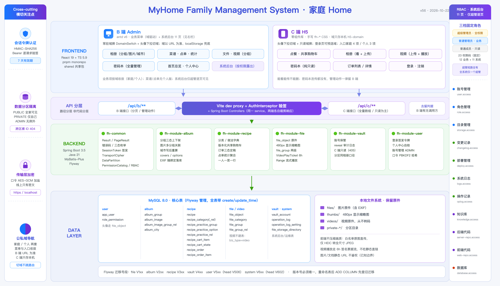

# 系统总览

## 架构图

## 项目定位

**MyHome（家庭 Home）** 是一个面向家庭的综合管理系统，涵盖相册、菜谱、点单、视频、文档、密码本等核心模块，支持多用户协同与数据分区隔离，B 端（admin，antd v6）负责管理、C 端（h5，零组件库）负责日常使用。

## 技术栈

### 后端
- **框架**: Spring Boot 3.5 + Java 21
- **ORM**: MyBatis-Plus
- **数据库迁移**: Flyway
- **数据库**: MySQL 8.0 (utf8mb4_0900_ai_ci)
- **存储**: 本地文件系统 + FileSystemResource (HTTP Range 支持)
- **认证**: HMAC-SHA256 Bearer Token (7天有效期)

### 前端
- **框架**: React 19.3 + TypeScript 5.9.3
- **构建工具**: Vite 8.3
- **包管理**: pnpm monorepo (admin/h5/shared)
- **UI 库**: antd v6 (B端), 原生 HTML (C端)
- **路由**: React Router v6

### 部署
- **日志**: prod 保留 7 天 (logback rolling policy)
- **端口**: 后端 8080, admin 自动递增, h5 自动递增
- **HTTPS**: 传输层加密要求 https/localhost

## 核心架构原则

### 1. 数据分区隔离
- **PUBLIC（公共）**: owner_id = 0, 全家可见
- **PRIVATE（个人）**: owner_id = 当前账号, 仅本人可见
- **ADMIN 无例外**: 管理员不能绕过私人隔离
- **跨区裸 ID 404**: 防止枚举攻击

### 2. C/B 端接口分层
- **路径分层**: `/api/c/**` vs `/api/b/**`, 不是代码分层
- **去留判据**: B 端有无调用方
- **复用实现**: 同一 service, 不同响应裁剪

### 3. 会话令牌认证
- **格式**: `v1.<userId>.<exp>.<HMAC-SHA256>`
- **密钥**: `fh.auth.token-secret` (dev 公开, prod 环境变量)
- **拦截器**: 逐请求验签 + 验 7 天有效期
- **X-User-Id 整条下线**: 无任何回退

### 4. 传输层加密
- **口令传输**: AES-GCM 加盐加密 (PBKDF2-HMAC-SHA256, 10万轮)
- **五处出入口**: B/C 登录、个人中心改口令、密码本新建/编辑
- **反方向**: 只有密码本 reveal 需要解密 (前端解密共四处文件六出入口, 只准写在 api 层)
- **硬约束**: https/localhost (Web Crypto API 要求)

### 5. 公私域 (Domain) 驱动的两端导航
- **概念**: `Domain = 'FAMILY' | 'PERSONAL'`, B/C 两端各一套菜单/入口按域收敛, 不再让公私两套入口同屏冗余并存
- **B 端** (v24): `lib/domain.ts` + `useDomain()`; 域**以 URL 为准** + `localStorage('admin-domain')` 兜底; 刻意不用 React context (三处独立读同一 location, 永不脱钩); 切域跳当前模块对应档, 无对应档回退落地页
- **C 端** (v27/v29): 首页 URL 就是 `/`、**没有 scope 段可派生**, 故域**只存本机 `h5-domain`**; **切域不跳路由**, 只换首页展示的入口; 切域入口在头像下拉, 域牌只读; 登录页可预选域
- **可见性说明** (v30): 整句版只在 C 端登录页 (域概念第一次被遇到的那一屏讲透一次), 短版「家庭全家可见 · 个人仅自己可见」用在两端切域处; C 端抽成常量 `DOMAIN_VISIBILITY_HINT` 两处共用
- **域无关模块**: 首页/菜谱/点单/账号管理无个人版; 菜谱是家庭共享, 只在家庭域出现

### 6. 三档固定角色 RBAC (v48~v51)
- **三档角色**: `UserRole = SUPER_ADMIN | ADMIN | MEMBER`, 固定枚举不可增删; 可配置的只有「每档勾选了哪些权限」
- **权限目录**: `PermissionCatalog` (fh-common) 写死 23 码——6 个业务模块各 `.view`/`.manage` 两档 (12 码) + 11 个系统后台页各一个 `.access` (11 码); 权限项与角色都不让超管在页面上增删 (否则成了"自己给自己造钥匙")
- **勾选矩阵**: 存 `role_permission` 表 (V506, role+permission 联合主键), 超管在「角色管理」页编辑; SUPER_ADMIN 不入库, 在 `can(user, code)`/`resolve` 里短路拥有全部权限
- **后端门禁分工 (关键)**: 写操作 (建/改/删) 逐个 `requirePermission(<mod>.manage)`, 系统后台页逐个 `requirePermission(<page>.access)`; **业务读接口只要登录态、不由 `.view` 在后端拦** (`.view` 只驱动前端菜单可见性与路由 403, 这是"普通成员只读浏览业务数据"要的)
- **`requireSuperAdmin()` 单独守两条**: 改角色 (`PUT /user/{id}/role`) 与存矩阵 (`PUT /role/permissions`)——它不在权限矩阵里、无法被授予 (超管身份是硬编码短路), 故普通管理员即便被勾上 `ROLE_ACCESS` 也改不了角色
- **单超管不变式 (v50)**: 全系统只能有一个超级管理员——禁止提第二人、超管那一行不可改角色/不可删、不能改自己角色; 角色下拉里「超级管理员」永久置灰; 账号删除只挡超管 (普通管理员/普通成员都可删, 放宽 v48 旧护栏)
- **前端判据唯一来源**: `@family-home/shared/auth` 的 `can(user, code)`; 任何 `role === 'ADMIN'` 的写法对超管 (role=SUPER_ADMIN) 都会假, 故一律用 `can()` 而非直接比 role

## 系统后台 (运维/治理面, 仅 B 端)

v39 起在 B 端 ADMIN+家庭域侧栏逐步长出一组「系统后台」页 (v47 归组), 每页一个 `<page>.access` 权限码, 默认只有超级管理员勾选, 逐个接口 `requirePermission` 兜底 (藏菜单只是体验, 敲接口照样 403)。这些页的服务实现大多落在 **fh-boot** (不新建业务模块), 共 11 项:

| 页面 | 路由 | 权限码 | 版本 | 职责 |
|------|------|--------|------|------|
| 账号管理 | `/user` | `user.access` | v6/v48/v50 | 账号增删改 + 设角色 (仅超管可改, 单超管不变式) |
| 角色管理 | `/role` | `role.access` | v48 | 23 码 × 3 档可编辑权限勾选矩阵 (仅超管可存) |
| 目录管理 | `/storage` | `storage.access` | v36~v38 | 多目录存储登记 + 默认上传切换 + 目录占用统计 |
| 变更记录 | `/change-log` | `changelog.access` | v39/v40 | 两仓 commit 全量 (GitHub API 实时优先 + 构建期快照兜底), 标「当前运行版本」 |
| 部署管理 | `/deploy` | `deploy.access` | v41/v42 | 「部署最新」(分离 launcher 拉起 + 进度文件跨重启接续) + 部署历史 |
| 系统日志 | `/logs` | `logs.access` | v43/v44/v46 | 多文件切换 + 实时 tail (~1.5s 轮询增量) + 保留天数驱动 logback + traceId 过滤回溯 |
| 操作记录 | `/operation-logs` | `oplog.access` | v45/v46 | 读写全审计 + B/C 端区分 + 页面头/动作字典 + 出入参脱敏 + 保留天数 + traceId |
| 知识库 | `/knowledge` | `knowledge.access` | v49 | 在线浏览/编辑 MyHome--Knowledge 仓库文本文件 + 一键 git push |
| 后端代码 | `/server-repo` | `server-repo.access` | v51 | 在线浏览/编辑 family-home-server 源码 + 一键 git push |
| 前端代码 | `/web-repo` | `web-repo.access` | v51 | 在线浏览/编辑 family-home-web 源码 + 一键 git push |
| 数据库 | `/database` | `database.access` | v52~v56 | 可视化表数据 CRUD + 结构化改表 (含表说明) + 只读索引清单 + 任意 SQL + 每日备份 |

**几条共性口径**:
- **在线编辑三页 (知识库/后端代码/前端代码) 共用 `RepoService` 引擎** (v51 把 v49 的知识库机制泛化): 浏览目录树 + 编辑文本白名单文件 + 本地保存 + 一键 `git add/commit/push`; 推送是**进程内同步跑** (不杀后端, 与部署的分离 launcher 本质不同); 仓库根目录靠 env 配 (`FH_KNOWLEDGE_REPO_DIR`/`FH_SERVER_REPO_DIR`/`FH_WEB_REPO_DIR`), 未配置则优雅降级 `available:false`
- **部署必须分离 launcher**: 「部署最新」的后端正是要被 `taskkill` 重启的那个, 故后端只「分离拉起 `FH_DEPLOY_LAUNCHER` + 读 `FH_DEPLOY_PROGRESS_FILE`」, 进度靠文件跨重启接续 (新后端读同一文件、前端轮询无缝续)
- **审计 traceId 一值三处同值** (v46): 每行日志的 `[traceId]` 段 + `operation_log.trace_id` 列 + 响应头 `X-Trace-Id` 逐字相同; `TraceIdFilter` (最高优先级) 用 MDC + request attribute 双写, 审计异步落库从 request attribute 取 (MDC 不跨线程); 系统日志页按 traceId 客户端过滤做回溯 (v43「极简无过滤器」的唯一定向例外)
- **数据库页是全系统权限最高页** (v52): 能跑任意 SQL (读+写+DDL, 无语句白名单, 风险由前端二次确认 + 仅超管门禁兜)、能改表结构、能删数据; 标识符逐个 `^[A-Za-z0-9_]+$` 校验 + 反引号包裹, 值一律 `PreparedStatement` 占位符; 备份走 `mysqldump` 到 `<install>/backups/`, 凭据写进用完即删的 0600 临时选项文件
- **系统后台新增数据表**: `role_permission` (V506, 权限矩阵)、`operation_log` + `operation_log_setting` (V600, 审计流水 + 保留天数)、`file_storage_directory` (V110, 多目录存储登记); `operation_log.trace_id` 由 V601 补列; V602 批量补齐历史遗留的空列注释 (含 8 个 STORED 生成列), Flyway head 现为 system 域 `V602` / user 域 `V506`

## 模块边界

| 模块 | Maven artifactId | 职责 |
|------|------------------|------|
| fh-common | fh-common | Result/PageResult/异常/错误码/三态枚举/SessionToken/TransportCipher/UserRole/PermissionCatalog/CurrentUserHolder |
| fh-boot | fh-boot | 启动类/配置/静态映射/异常处理/health + 系统后台服务 (ChangeLog/Deploy/Log/OperationLog/TraceIdFilter/Repo·Knowledge·CodeRepo/Database) |
| fh-module-album | fh-module-album-biz | 相册分组/图片/城市分布/上下架 |
| fh-module-recipe | fh-module-recipe-biz | 菜谱/分类/做法/购物车/订单 |
| fh-module-file | fh-module-file-biz | 文件上传/下载/分类/文档/视频 |
| fh-module-vault | fh-module-vault-biz | 密码本/账号保管 |
| fh-module-user | fh-module-user-biz | 账号管理/登录/个人中心 |

## 关键特性

1. **版本化购物车**: 共享购物车原子幂等消费 (V317 recipe_cart_state/version); 一人一菜一行 (V505 uk_recipe_creator, 同菜不同加购人各占一行)
2. **预签名流式播放**: VideoPlayTicket 6h 签名票据 (不复用登录令牌)
3. **FileSystemResource**: HTTP Range/206 支持 (seek/快进必需)
4. **关联表驱动**: album_image_group_rel 是分组归属唯一来源; file_group_rel 同理管文档/视频分组 (V108/V109)
5. **软删 + 物理删**: markDeletedAndPurge (先软删行, 后物理删文件); 分组类字典 (file_category/file_group) 是硬删
6. **保留原件**: 前端不压缩画质 (`prepareImageForUpload` 白名单原图直传, 仅 HEIC 转全尺寸 JPEG); 后端另存独立 480px 显示缩略图, 视频从不转码
7. **三档角色 RBAC + 系统后台**: 23 权限码 × 3 档勾选矩阵 (`role_permission`/V506), 超管短路全有; 11 个系统后台页 (账号/角色/目录/变更记录/部署/日志/操作记录/知识库/后端代码/前端代码/数据库) 逐页 `.access` 门禁, 详见上「系统后台」节

## C 端能力边界 (与 B 端逐档对比)

| 模块 | C 端 (h5) | B 端 (admin) |
|------|-----------|--------------|
| 相册 | 看在架图/组 + 上传 (必选现有分组, 不给新建) | 全量管理 + 建组/上下架/排序/删除 |
| 视频 | 看 + **上传** (v26 起; 一级可选多组/二级固定组/「全部」页无入口) | 全量管理 + 分组管理 + 删除 |
| 密码本 | **纯只读** (v28 起: 列表 + reveal 取回口令, 写路径 405) | 新建/编辑/删除/reveal |
| 文档 (文件管理) | **不下沉 C 端** | 全量管理 + 分组 |
| 菜谱/点单 | 点餐 + 购物车 + 订单 (家庭域专属) | 菜谱/分类/做法/点单管理/统计 |
| 账号 | 无个人中心、无切换账号, 注销只清本机身份 | 个人中心 (改昵称/手机号/口令/头像) + ADMIN 账号管理 |

**共同边界**: C 端"能看 (能传) 不能删/改管理"; 删除与管理动作一律留 B 端。

## 已下线概念

- **菜品"标签"** (V314 删表): 菜谱只剩分类 + 做法两个维度
- **菜谱"类型"** (V303 重构): 多对多改为一菜一分组
- **C 端"餐段"标签条** (V313 删字典): 早/午/晚三个标签已删除
- **订单"改回待制作"** (/reopen 已下线): 已完成与已取消都是定稿档
- **X-User-Id 身份头** (v15 堵洞): 换成服务端签发 HMAC Bearer token
- **B 端公私两套平级一级菜单** (v24): 改由公私域驱动, 每域一套菜单
- **C 端首页五张平铺卡** (v27): 按域收敛成家庭 4 项 / 个人 3 项
- **C 端首页可点域牌按钮 + 交换箭头** (v29): 域牌改只读, 切域入口移进头像下拉
- **C 端「家庭 Home」大标题** (v31): 首页与登录页都删掉, 只剩副标题「我们的小窝」升为 h1; 这五个字此后只有 B 端侧栏渲染

## 风险与边界

### 风险 1: 静态文件 URL 不鉴权
- 视频走签名票据故不受影响
- 图片/文档静态 URL 仍可直接访问

### 风险 14: scope 是可见性分区, 不是权限边界
- B 端只做到"列出来只有自己的"
- 改/删/绑与图片分页吃的是裸 id, 一律不判属主
- C 端四处全堵 (服务端 gate)

### 边界: 传输层加密 ≠ 访问控制
- 盐两端成对且随 bundle 公开
- 换来的硬约束是 https/localhost
- 存储层哈希/加密未改动

---

*最后更新: 2026-10-22*
